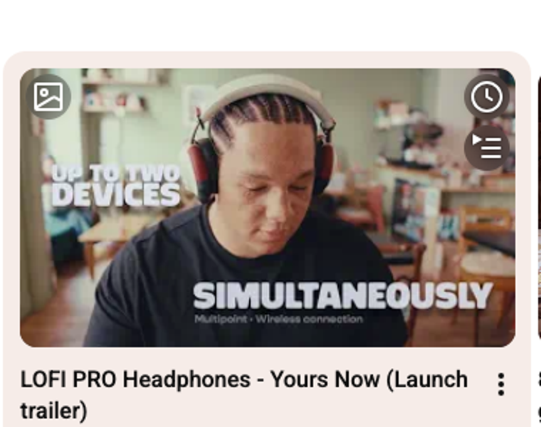
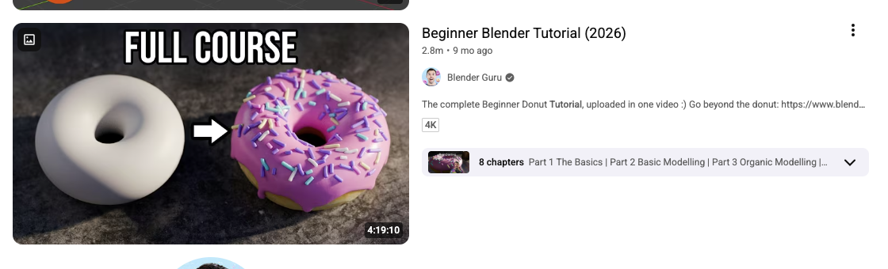
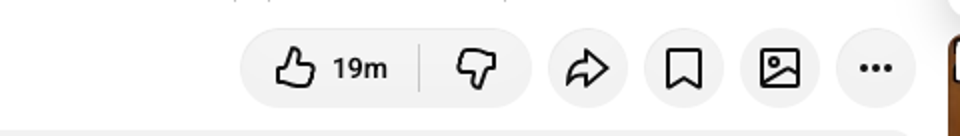
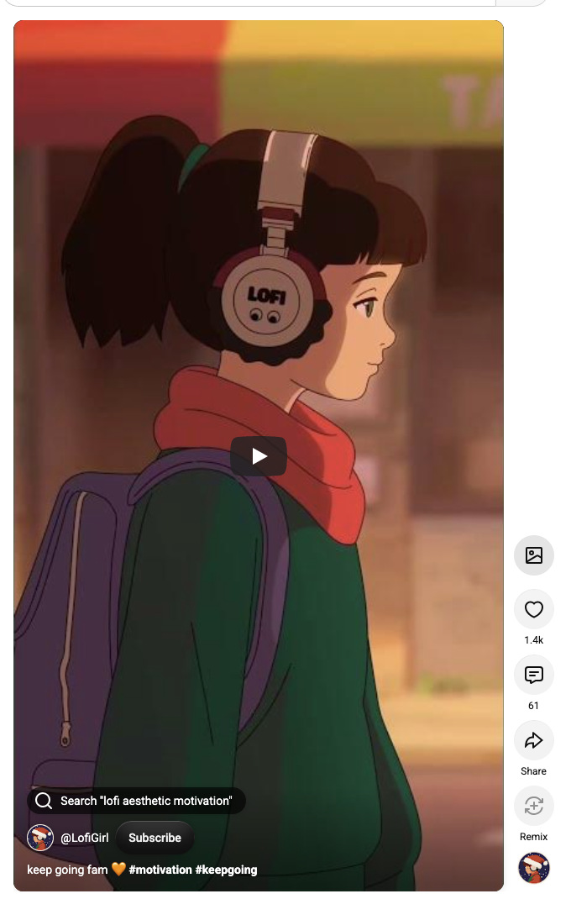

# YouTube Thumbnail Downloader

A small Chrome extension that adds one clean button for saving any YouTube thumbnail in the best available quality.

It blends into YouTube's own interface: it uses YouTube's icon set, copies the style of its buttons and adds no text labels.

## Screenshots

**Home, Subscriptions and channel pages**: hover a thumbnail and the button appears next to Watch Later and Add to Queue.



**Search**



**Watch page**: next to Share and Save.



**Shorts**: at the top of the action bar.



## What you get

- **Videos:** the largest thumbnail available (1280×720 when there is one), falling back to smaller sizes automatically.
- **Shorts:** the original vertical image (1080×1920).
- **File name:** `Video title [videoId].jpg`, saved to your Downloads folder.

## Install

1. Download or clone this repo.
2. Open `chrome://extensions` and turn on **Developer mode**.
3. Click **Load unpacked** and select the repo folder.

## Development

No build step. The files are plain JS and CSS in `src/`. They were tested with [agent-browser](https://github.com/vercel-labs/agent-browser) using the scripts in `scripts/`:

```bash
scripts/launch-test-browser.sh "https://www.youtube.com/results?search_query=lofi"
scripts/hover-click.sh "ytd-video-renderer ytd-thumbnail" 1 shot.png
```
